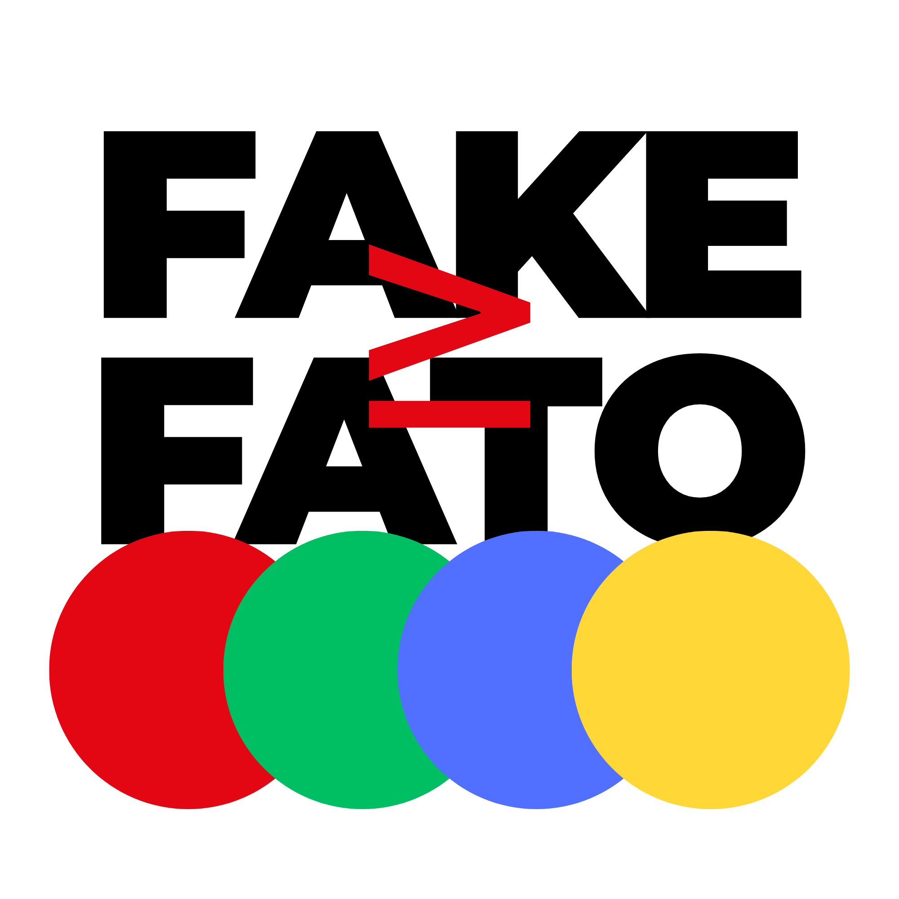

  

<h1 align="center">📰 FAKE OU FATO?</h1>

<h3 align="center">EDUCAÇÃO DIGITAL • INFORMAÇÃO • PENSAMENTO CRÍTICO</h3>

  <strong>Você consegue descobrir o que é verdade e o que é mentira na internet?</strong>

  

  
  
  

---

## 📌 SOBRE O PROJETO

O **FAKE OU FATO?** é uma plataforma educativa e interativa desenvolvida para trabalhar a educação digital de maneira dinâmica, participativa e divertida.

Por meio de uma competição entre equipes, os estudantes são desafiados a investigar notícias, consultar fontes, analisar informações e descobrir se determinado conteúdo é verdadeiro ou falso.

A proposta é transformar a verificação de notícias em uma experiência de aprendizagem, incentivando o pensamento crítico e o uso consciente da internet.

> 💡 Uma informação não deve ser aceita apenas porque apareceu na internet. É preciso investigar!

---

## 🎮 COMO FUNCIONA?

O jogo foi desenvolvido para ser utilizado em sala de aula, com uma televisão ou projetor exibindo as perguntas e computadores disponíveis para a pesquisa dos grupos.

### 👥 01. Formação das equipes

A turma é dividida em quatro grupos:

- 🔵 Grupo 01
- 🟢 Grupo 02
- 🟡 Grupo 03
- 🔴 Grupo 04

### 📰 02. Apresentação da notícia

Uma notícia é apresentada na tela principal. Os grupos precisam investigar seu conteúdo e decidir se a informação é FATO ou FAKE.

### ⏱️ 03. Tempo de investigação

Cada pergunta possui um cronômetro de **2 minutos e 30 segundos**.

Durante esse período, os grupos podem pesquisar na internet, comparar informações e consultar fontes confiáveis.

### 🔎 04. Revelação da resposta

Quando o tempo termina, o responsável pela atividade revela a resposta correta.

A plataforma apresenta:

- A classificação da notícia: FATO ou FAKE.
- Uma explicação sobre o conteúdo.
- A informação correta.
- A fonte utilizada na verificação.

### 🏆 05. Pontuação e ranking

Cada grupo que acertar recebe **10 pontos**.

Ao final das duas rodadas, o sistema apresenta automaticamente o ranking, organizando as equipes de acordo com a pontuação conquistada.

---

## 📊 ESTRUTURA DA PARTIDA

| Característica | Configuração |
|:---|:---|
| 👥 Equipes | 4 grupos |
| 🔄 Rodadas | 2 |
| 📰 Perguntas por rodada | 6 |
| 🔢 Total de perguntas | 12 |
| ⏱️ Tempo por pergunta | 2min30s |
| ⭐ Pontuação por acerto | 10 pontos |
| 🏆 Resultado | Ranking final |

---

## 📚 NÍVEIS DE ENSINO

A plataforma foi pensada para atender diferentes etapas da educação básica.

### 🎒 Ensino Fundamental

Perguntas com linguagem acessível e temas variados, incentivando a pesquisa e a identificação de informações falsas.

### 🎓 Ensino Médio

Questões que exigem maior análise, interpretação, comparação de fontes e investigação das informações apresentadas.

### 🎯 Níveis de dificuldade

- 🟢 Fácil
- 🟡 Médio
- 🔴 Difícil

---

## ⚙️ FUNCIONALIDADES

| Recurso | Descrição |
|:---|:---|
| 🎲 Jogo aleatório | Seleção de perguntas variadas |
| 📚 Escolher ensino | Seleção entre Fundamental e Médio |
| 🎯 Escolher dificuldade | Seleção do nível das perguntas |
| ⏱️ Cronômetro | Controle do tempo de investigação |
| 🔍 Verificação | Explicações e fontes das notícias |
| 🎮 Painel administrativo | Controle da partida |
| ⭐ Pontuação | Registro dos pontos dos grupos |
| 🏆 Ranking | Classificação final das equipes |

---

## 🔬 CRITÉRIOS DE VERIFICAÇÃO

As perguntas são construídas com base em acontecimentos e informações verificáveis.

A plataforma trabalha com duas classificações:

- 🟢 **FATO:** informação verdadeira, sustentada por fontes confiáveis.
- 🔴 **FAKE:** informação baseada em um conteúdo real, mas que apresenta algum detalhe adulterado.

O objetivo não é apenas revelar a resposta, mas mostrar aos participantes como identificar inconsistências e encontrar a informação correta.

---

## 🧠 OBJETIVOS EDUCACIONAIS

O projeto busca desenvolver habilidades importantes para a vida dentro e fora da internet:

- 🔎 Investigação e pesquisa.
- 🧩 Pensamento crítico.
- 🌐 Educação digital.
- 🤝 Trabalho em equipe.
- 🛡️ Combate à desinformação.
- 📖 Identificação de fontes confiáveis.

---

## 💻 TECNOLOGIAS E PUBLICAÇÃO

| Tecnologia | Utilização |
|:---|:---|
| 🐙 GitHub | Hospedagem e gerenciamento do código-fonte |
| ▲ Vercel | Publicação e disponibilização da plataforma |

O site pode ser acessado diretamente pelo navegador, sem necessidade de instalação.

---

## 🌐 ACESSE O PROJETO

  

---

## ❤️ NOSSA PROPOSTA

A internet oferece acesso a uma quantidade enorme de informações, mas nem tudo o que encontramos é verdadeiro.

Saber pesquisar, questionar e verificar fontes é uma habilidade essencial no mundo atual.

O **FAKE OU FATO?** nasceu para transformar esse aprendizado em uma experiência interativa, mostrando que a informação de qualidade começa com uma simples pergunta:

<h2 align="center">🤔 É FATO OU FAKE?</h2>

  <strong>FAKE OU FATO?</strong> 
  Educação digital começa com informação de qualidade. 📰

